# LIVRABLE 2 : DOSSIER D'ARCHITECTURE TECHNIQUE & JUSTIFICATIONS
**Projet et Déploiement d'Infrastructure Cloud AWS (3-Tiers)**
*Établissement : TEK-UP — Promotion ING-4 (Module ING-4-CIM)*  
*Enseignant responsable : Hamdi Chebbi*

---

## 1. Schéma d'Architecture Détaillé (Mermaid Flowchart)

Ce schéma est strictement conforme aux ressources déclarées dans le code Terraform (`infra/modules/`).

```mermaid
flowchart TB
    %% Utilisateurs et API externes
    Client(["Navigateur Client / Utilisateur Web"])
    ExtAPI["APIs Publiques Externes<br/>(Dépôts Linux / TMDB API)"]

    subgraph AWS_Cloud ["AWS Cloud (Région : us-east-1)"]

        subgraph Supervision ["Observabilité & Supervision (CloudWatch)"]
            CW_Dash["Dashboard Unifié CloudWatch<br/><code>cinetrekker-dev-supervision-dashboard</code><br/>(ALB, ASG, RDS, Erreurs 5xx)"]
            CW_Alarm1["Alarme 1 : <code>cinetrekker-dev-alarm-unhealthy-hosts</code><br/>(UnHealthyHostCount &gt;= 1 sur 60s)"]
            CW_Alarm2["Alarme 2 : <code>cinetrekker-dev-alarm-high-cpu</code><br/>(CPUUtilization &gt; 70% sur 2x60s)"]
            CW_Logs["Log Group : <code>/aws/ec2/cinetrekker-dev-app</code><br/>(Rétention : 1 jour)"]
        end

        subgraph S3_Tier ["Couche Stockage Objet & Secrets"]
            S3_Bucket[("Bucket S3 Privé Chiffré SSE-S3<br/><code>cinetrekker-dev-artifacts-account_id</code><br/>- app/cinetrekker.tar.gz<br/>- secrets/db_password.txt")]
        end

        subgraph VPC ["VPC Dédié : 10.0.0.0/16"]
            
            IGW["Internet Gateway (IGW)<br/><code>cinetrekker-dev-igw</code>"]
            S3_VPCE["VPC Gateway Endpoint S3<br/><code>cinetrekker-dev-s3-gateway-endpoint</code><br/>(Gratuit & Routage Préfixé Privé)"]

            %% Zone us-east-1a
            subgraph AZ_A ["Zone de Disponibilité : us-east-1a"]
                subgraph Pub_Sub_A ["Sous-réseau Public 1a (10.0.1.0/24)"]
                    ALB_Node_A["Nœud ALB Zone A"]
                    NAT_Inst["Instance NAT (t3.micro)<br/>Amazon Linux 2023 - 8 Go gp3<br/>iptables MASQUERADE<br/><code>nat-sg</code>"]
                end

                subgraph App_Sub_A ["Sous-réseau Privé Applicatif 1a (10.0.11.0/24)"]
                    EC2_A["Instance EC2 Applicative A (t3.micro)<br/>Amazon Linux 2023 - 20 Go gp3<br/>Node.js CineTrekker (Port 8080)<br/><code>app-sg</code>"]
                end

                subgraph DB_Sub_A ["Sous-réseau Privé DB 1a (10.0.21.0/24)"]
                    RDS_Primary[("Instance Primaire RDS PostgreSQL 15<br/>db.t3.micro - 20 Go gp3<br/>Port 5432 - <code>rds-sg</code>")]
                end
            end

            %% Zone us-east-1b
            subgraph AZ_B ["Zone de Disponibilité : us-east-1b"]
                subgraph Pub_Sub_B ["Sous-réseau Public 1b (10.0.2.0/24)"]
                    ALB_Node_B["Nœud ALB Zone B"]
                end

                subgraph App_Sub_B ["Sous-réseau Privé Applicatif 1b (10.0.12.0/24)"]
                    EC2_B["Instance EC2 Applicative B (t3.micro)<br/>Amazon Linux 2023 - 20 Go gp3<br/>Node.js CineTrekker (Port 8080)<br/><code>app-sg</code>"]
                end

                subgraph DB_Sub_B ["Sous-réseau Privé DB 1b (10.0.22.0/24)"]
                    RDS_Subnet_B[("Emplacement DB Subnet Group<br/>(Réserve Failover AZ-B)")]
                end
            end

            %% Composants logiques de répartition
            ALB["Application Load Balancer (ALB)<br/><code>cinetrekker-dev-alb</code> (Port 80 HTTP)<br/><code>alb-sg</code>"]
            ASG["Auto Scaling Group Multi-AZ<br/><code>cinetrekker-dev-asg-xxx</code><br/>Min: 2 | Desired: 2 | Max: 4"]

        end
    end

    %% Flux Inbound Utilisateur
    Client -->|"HTTP :80"| IGW
    IGW --> ALB
    ALB -.-> ALB_Node_A
    ALB -.-> ALB_Node_B
    ALB -->|"HTTP :8080 (Target Group /health)"| EC2_A
    ALB -->|"HTTP :8080 (Target Group /health)"| EC2_B

    %% Liens logiques ASG
    ASG -.- EC2_A
    ASG -.- EC2_B

    %% Flux Outbound via NAT
    EC2_A -->|"Route 0.0.0.0/0 (NAT)"| NAT_Inst
    EC2_B -->|"Route 0.0.0.0/0 (NAT)"| NAT_Inst
    NAT_Inst -->|"SNAT vers Internet"| IGW
    IGW -->|"Paquets Linux / Appels API"| ExtAPI

    %% Flux Base de Données (Port 5432)
    EC2_A -->|"TCP :5432 (app-sg -> rds-sg)"| RDS_Primary
    EC2_B -->|"TCP :5432 (app-sg -> rds-sg)"| RDS_Primary

    %% Flux S3 via VPC Endpoint Direct
    EC2_A -->|"Trafic S3 Direct (Endpoint)"| S3_VPCE
    EC2_B -->|"Trafic S3 Direct (Endpoint)"| S3_VPCE
    S3_VPCE --> S3_Bucket

    %% Télémétrie et Supervision
    ALB -->|"Métriques Cibles & Codes 5xx"| Supervision
    ASG -->|"Métriques CPU & Instances"| Supervision
    EC2_A -->|"Logs user-data via CloudWatch Agent"| CW_Logs
    EC2_B -->|"Logs user-data via CloudWatch Agent"| CW_Logs
    RDS_Primary -->|"Connexions & CPU"| CW_Dash
```



---

## 2. Découpage Réseau et Matrice de Sécurité

### 2.1 Plan d'Adressage Réseau (VPC `10.0.0.0/16`)

| Sous-réseau | Zone (AZ) | Bloc CIDR | Type | Rôle & Composants | Passerelle / Routage |
| :--- | :---: | :---: | :---: | :--- | :--- |
| `cinetrekker-dev-public-subnet-1a` | `us-east-1a` | `10.0.1.0/24` | Public | Nœud ALB A, Instance NAT EC2 | `0.0.0.0/0` $\rightarrow$ Internet Gateway |
| `cinetrekker-dev-public-subnet-1b` | `us-east-1b` | `10.0.2.0/24` | Public | Nœud ALB B | `0.0.0.0/0` $\rightarrow$ Internet Gateway |
| `cinetrekker-dev-private-app-subnet-1a` | `us-east-1a` | `10.0.11.0/24` | Privé | EC2 App (ASG Zone A) | `0.0.0.0/0` $\rightarrow$ ENI NAT Instance + S3 VPCE |
| `cinetrekker-dev-private-app-subnet-1b` | `us-east-1b` | `10.0.12.0/24` | Privé | EC2 App (ASG Zone B) | `0.0.0.0/0` $\rightarrow$ ENI NAT Instance + S3 VPCE |
| `cinetrekker-dev-private-db-subnet-1a` | `us-east-1a` | `10.0.21.0/24` | Isolé | RDS PostgreSQL Primary | Aucun accès sortant (Table locale isolée) |
| `cinetrekker-dev-private-db-subnet-1b` | `us-east-1b` | `10.0.22.0/24` | Isolé | RDS Subnet Group Réserve | Aucun accès sortant (Table locale isolée) |

### 2.2 Matrice des Groupes de Sécurité (Moindre Privilège par Référencement Croisé)

Aucun groupe de sécurité interne n'autorise d'adresses IP directes. L'étanchéité repose sur le **Security Group Chaining** :

```
[alb-sg] --(TCP 8080)--> [app-sg] --(TCP 5432)--> [rds-sg]
                            │
                            └──(Tout trafic interne)--> [nat-sg] --> (0.0.0.0/0 Internet)
```

1. **`cinetrekker-dev-alb-sg`** :
   * Ingress : `TCP 80` depuis `0.0.0.0/0` (Trafic web public).
   * Egress : `TCP 8080` restreint strictement vers `cinetrekker-dev-app-sg`.
2. **`cinetrekker-dev-app-sg`** :
   * Ingress : `TCP 8080` restreint strictement depuis `cinetrekker-dev-alb-sg`.
   * Egress : `TCP 5432` vers `cinetrekker-dev-rds-sg` ; `TCP 443` vers S3 et APIs AWS ; `UDP/TCP 53` vers DNS Amazon ; `TCP 80` vers dépôts de paquets via NAT.
3. **`cinetrekker-dev-rds-sg`** :
   * Ingress : `TCP 5432` autorisé exclusivement depuis `cinetrekker-dev-app-sg`.
   * Egress : Aucun trafic sortant autorisé (fermeture hermétique).
4. **`cinetrekker-dev-nat-sg`** :
   * Ingress : Tout trafic depuis les sous-réseaux applicatifs (`10.0.11.0/24` et `10.0.12.0/24`).
   * Egress : Tout trafic vers `0.0.0.0/0` pour translation d'adresse source (SNAT).

> [!IMPORTANT]
> **Règle absolue d'administration** : Aucun port d'administration distante (22 SSH ou 3389 RDP) n'est exposé sur Internet. L'accès opérateur aux instances s'effectue exclusivement au moyen d'**AWS Systems Manager (SSM) Session Manager** via le profil d'instance `LabInstanceProfile`.

---

## 3. Tableau de Justification des Services AWS (5 Axes d'Architecture)

Chaque choix d'infrastructure est ici justifié selon les 5 piliers du Cloud (*Disponibilité, Performance, Sécurité, Scalabilité, Coût*), sur la base de la configuration réelle codée dans Terraform.

| Service & Configuration Réelle | 1. Disponibilité | 2. Performance | 3. Sécurité | 4. Scalabilité | 5. Coût |
| :--- | :--- | :--- | :--- | :--- | :--- |
| **VPC & Sous-réseaux Multi-AZ** (`10.0.0.0/16`, 6 sous-réseaux) | Répartition sur 2 AZs distinctes (`us-east-1a` et `us-east-1b`) éliminant le risque de panne matérielle locale. | Segmentation en sous-réseaux réduisant les domaines de diffusion et latence inter-AZ minimale (< 1 ms). | Isolation étanche en 3 tiers : public (ALB/NAT), privé applicatif, et base isolée sans route Internet. | Adressage dimensionné (/24 offrant 251 adresses utiles par subnet) prêt pour l'ajout d'instances. | Service natif entièrement **gratuit** sur AWS, optimisant le crédit de 50 USD. |
| **Application Load Balancer** (`cinetrekker-dev-alb`) | Équilibre le trafic entre les AZs et évince les cibles défaillantes sous 30s via les health checks `/health`. | Décharge SSL/TLS et routage optimisé HTTP niveau 7 avec faible surcoût de latence. | Point d'entrée public unique ; bloque les flux non web et masque l'adressage interne des serveurs EC2. | Ajuste automatiquement sa capacité interne face à l'accroissement du trafic sans re-dimensionnement manuel. | Facturé ~0,0225 $/h (~0,07 $ par session de TP de 3h), détruit systématiquement après chaque séance. |
| **Auto Scaling Group** (Min: 2, Desired: 2, Max: 4) | Maintient au moins 2 instances actives réparties sur les 2 AZs ; remplace automatiquement tout nœud défaillant en < 5 min. | Charge répartie équitablement entre instances pour garantir une latence sous 150 ms sous charge nominale. | Les instances résident en sous-réseaux privés sans adresse IP publique, inatteignables directement depuis Internet. | Élasticité automatique de 2 à 4 instances `t3.micro` selon la politique de charge CPU. | Service de gestion **gratuit** ; on ne paie que les instances EC2 actives sous-jacentes. |
| **Instances EC2 Applicatives** (`t3.micro`, Amazon Linux 2023) | Haute disponibilité assurée par le placement multi-AZ orchestré par l'ASG. | 2 vCPU et 1 Go RAM optimisés par le runtime natif Node.js ESM léger (< 120 Mo de RAM utilisés). | Rôle IAM `LabInstanceProfile` sans clés statiques ; disques EBS gp3 chiffrés par défaut (AES-256). | Remplacement et montée en charge horizontaux en ajoutant des instances identiques via le Launch Template. | Tarif très avantageux de ~0,0104 $/h par instance, idéal pour le budget Learner Lab. |
| **Instance NAT EC2** (`t3.micro` avec `iptables-nft`) | Suffisante pour une charge d'atelier ; les flux vers S3 sont déchargés sur le VPC Endpoint haute disponibilité. | Débit largement supérieur aux besoins de mise à jour de paquets applicatifs et requêtes API sortantes. | Restreinte par `nat-sg` : accepte uniquement les paquets issus des sous-réseaux privés applicatifs. | Suffisante pour la charge du projet (une seule instance NAT dans le sous-réseau public 1a). | **Économie majeure (ADR-01)** : ~0,0104 $/h vs ~0,045 $/h pour un NAT Gateway managé (économie de 75%). |
| **VPC Gateway Endpoint S3** (`com.amazonaws.us-east-1.s3`) | Haute disponibilité native managée par l'infrastructure AWS, indépendante de l'instance NAT. | Bande passante réseau interne AWS optimale pour le téléchargement rapide du bundle `cinetrekker.tar.gz`. | Les transferts restent cantonnés au backbone privé AWS sans jamais transiter sur l'Internet public. | Évolutivité illimitée et transparente gérée par AWS pour le trafic vers les buckets S3. | **100% gratuit** sans aucun frais d'ingestion ou de traitement de données (ADR-05). |
| **Amazon RDS PostgreSQL** (`db.t3.micro`, Single-AZ, 20 Go gp3) | Disponibilité garantie par les sauvegardes automatiques quotidiennes et la persistance managée par AWS. | Moteur PostgreSQL 15 optimisé sur stockage SSD gp3 chiffré (3000 IOPS de base). | Aucun accès public (`publicly_accessible = false`) ; accessible uniquement depuis `app-sg` sur le port 5432. | Redimensionnement vertical de classe d'instance et stockage auto-extensible activable. | **Économie ciblée (ADR-03)** : Single-AZ à ~0,021 $/h (instance + stockage) pour préserver le budget étudiant. |
| **Bucket Amazon S3** (`cinetrekker-dev-artifacts-...`) | Durabilité de 99,999999999% (11 9s) sur les artefacts et secrets de déploiement. | Téléchargement parallèle à haute vitesse au boot des instances EC2 via le S3 Gateway Endpoint. | Accès public strictement bloqué (`BlockPublicAccess`) et chiffrement côté serveur par défaut (SSE-S3 AES-256). | Capacité de stockage virtuellement infinie sans provisionnement préalable. | Coût négligeable (< 0,01 $/mois pour ~50 Mo d'artefacts) et compatible avec le crédit Free Tier. |
| **Amazon CloudWatch** (Logs, Dashboard, 2 Alarmes) | Service managé résilient accessible en continu pour surveiller l'état de l'infrastructure. | Agrégation et affichage quasi instantané des métriques avec période de rafraîchissement de 60 secondes. | Journalisation des logs système protégée par les autorisations IAM de `LabInstanceProfile`. | Supporte l'ingestion de flux de logs croissants sans saturation. | **Optimisation stricte (ADR-06)** : Rétention des logs fixée à **1 jour** pour éliminer tout surcoût de stockage. |

---

## 4. Estimation Financière Détaillée et Suivi Budgétaire

### 4.1 Inventaire des Ressources Facturables (Extraites du Code Terraform)

> [!NOTE]
> Les prix indiqués ci-dessous correspondent aux tarifs publics officiels en vigueur pour la région **`us-east-1` (Virginie du Nord)**. Ces estimations sont données à titre indicatif et doivent être validées avec l'**AWS Pricing Calculator**.

| Ressource Déployée | Paramètres / Taille (Lus dans le code) | Quantité | Coût Unitaire par Heure | Coût Total par Heure | Coût Estimé par Mois (730 h) |
| :--- | :--- | :---: | :---: | :---: | :---: |
| **Instances Applicatives EC2** | Type `t3.micro` (Linux, 2 vCPU, 1 Go RAM) | 2 | 0,0104 USD | 0,0208 USD | 15,18 USD |
| **Instance NAT EC2** | Type `t3.micro` (Amazon Linux 2023) | 1 | 0,0104 USD | 0,0104 USD | 7,59 USD |
| **Stockage EBS EC2 (App)** | Volumes racines gp3 chiffrés de 20 Go | 2 (40 Go) | ~0,00011 USD / Go-h | 0,0044 USD | 3,20 USD |
| **Stockage EBS EC2 (NAT)** | Volume racine gp3 chiffré de 8 Go | 1 (8 Go) | ~0,00011 USD / Go-h | 0,0009 USD | 0,64 USD |
| **Application Load Balancer** | 1 ALB public multi-AZ + 1 LCU nominal | 1 | 0,0225 USD + LCU | ~0,0240 USD | 17,52 USD |
| **Instance Amazon RDS** | PostgreSQL 15, `db.t3.micro`, Single-AZ | 1 | 0,0180 USD | 0,0180 USD | 13,14 USD |
| **Stockage RDS gp3** | Stockage alloué de 20 Go gp3 chiffré | 20 Go | ~0,00016 USD / Go-h | 0,0032 USD | 2,30 USD |
| **Stockage Amazon S3** | Artefact `cinetrekker.tar.gz` + secret (~50 Mo) | ~0,05 Go | Négligeable | < 0,0001 USD | < 0,01 USD |
| **VPC Gateway Endpoint S3** | Passerelle interne vers Amazon S3 | 1 | **0,0000 USD** | **0,0000 USD** | **0,00 USD** |
| **CloudWatch (Logs & Alarmes)** | Log group (rétention 1j) + 2 alarmes métriques | 1 | < 0,0005 USD | ~0,0005 USD | ~0,35 USD |
| **TOTAL GÉNÉRAL** | — | — | — | **~0,0822 USD / h** | **~60,00 USD / mois** |

---

### 4.2 Analyse d'Impact Financier & Scénarios d'Oubli

#### A. Coût Réel d'une Séance de Travail Typique (3 heures)
$$3 \text{ heures} \times 0,0822 \text{ USD/h} \approx \mathbf{0,25 \text{ USD}}$$
*Déployer l'infrastructure pour une démonstration ou une séance de TP complète coûte **moins de 25 centimes de dollar**, soit 0,5% du crédit total alloué (50 USD).*

#### B. Impact d'un Oubli de Destruction pendant 1 Semaine (168 heures)
$$168 \text{ heures} \times 0,0822 \text{ USD/h} \approx \mathbf{13,81 \text{ USD}}$$
*Un oubli de destruction de seulement 7 jours consécutifs consommerait **près de 28% du crédit total de 50 USD** du compte étudiant.*

#### C. Impact d'un Oubli pendant 1 Mois Complet (730 heures)
$$730 \text{ heures} \times 0,0822 \text{ USD/h} \approx \mathbf{60,00 \text{ USD}}$$
*Un mois d'oubli continu **dépasserait le budget total de 50 USD**, provoquant le blocage définitif du compte AWS Academy Learner Lab.*

> [!CAUTION]
> **Conclusion Opérationnelle** :
> Ces calculs démontrent mathématiquement la nécessité vitale d'exécuter le script de destruction (`scripts/destroy.ps1` ou `LANCER_DESTROY_AWS.bat`) dès la fin de chaque séance d'évaluation ou d'expérimentation.
