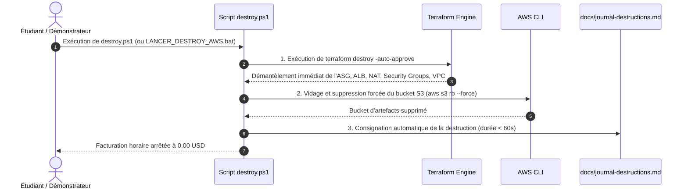

# LIVRABLE 3 : RAPPORT D'INFRASTRUCTURE, AUTOMATISATION & GUIDE DE DÉMONSTRATION
**Projet et Déploiement d'Infrastructure Cloud AWS (Livrables L1-L3)**
*Établissement : TEK-UP — Promotion ING-4 (Module ING-4-CIM)*  
*Enseignant responsable : Hamdi Chebbi*

---

## 1. Description Détaillée de l'Infrastructure Déployée par IaC

L'intégralité de l'infrastructure est codée en **Terraform modulaire** (`infra/modules/`) orchestrée par l'environnement de développement (`infra/environments/dev/main.tf`). Aucune ressource n'est créée manuellement via la console AWS.

```
infra/
├── environments/dev/
│   ├── main.tf              # Orchestration des 4 modules avec passage des variables
│   ├── variables.tf         # Paramètres par défaut (région us-east-1, préfixe cinetrekker-dev)
│   └── outputs.tf           # Sorties (URL ALB, /health, IP NAT, bucket S3)
└── modules/
    ├── reseau/              # VPC 10.0.0.0/16, 6 sous-réseaux multi-AZ, NAT instance, S3 Endpoint
    ├── securite/            # Groupes de sécurité chaînés par référence (alb-sg, app-sg, nat-sg)
    ├── stockage/            # Bucket S3 privé chiffré SSE-S3 AES-256 pour le package applicatif
    └── calcul/              # ALB public, Target Group /health, Launch Template, ASG multi-AZ
```

### 1.1 Réseau et Segmentation Multi-AZ (`modules/reseau`)
* **VPC Dédié** : Bloc d'adresses `10.0.0.0/16` avec résolution et noms d'hôtes DNS activés (`enable_dns_hostnames = true`).
* **Découpage en 6 Sous-réseaux (3 Tiers $\times$ 2 Zones de Disponibilité)** :
  1. `cinetrekker-dev-public-subnet-1a` (`10.0.1.0/24`, `us-east-1a`) : Nœud ALB 1 et Instance NAT.
  2. `cinetrekker-dev-public-subnet-1b` (`10.0.2.0/24`, `us-east-1b`) : Nœud ALB 2.
  3. `cinetrekker-dev-private-app-subnet-1a` (`10.0.11.0/24`, `us-east-1a`) : Première instance applicative EC2 (Zone A).
  4. `cinetrekker-dev-private-app-subnet-1b` (`10.0.12.0/24`, `us-east-1b`) : Instance applicative EC2 (Zone B).
  5. `cinetrekker-dev-private-db-subnet-1a` (`10.0.21.0/24`, `us-east-1a`) : Sous-réseau privé isolé (prévu pour le tiers persistance L5).
  6. `cinetrekker-dev-private-db-subnet-1b` (`10.0.22.0/24`, `us-east-1b`) : Sous-réseau privé isolé (prévu pour le tiers persistance L5).
* **Tables de Routage Explicites** :
  * **Table Publique** : Route `0.0.0.0/0` vers l'Internet Gateway (`cinetrekker-dev-igw`).
  * **Table Privée Applicative** : Route `0.0.0.0/0` vers l'interface réseau primaire (ENI) de l'instance NAT + Route préfixée locale vers le point de terminaison S3.
  * **Table Base de Données** : Aucune passerelle Internet associée (hermétique à tout trafic extérieur).
* **Point de Terminaison S3 Gateway Endpoint** : Relié directement aux tables publique et privée pour router le trafic vers Amazon S3 sans consommer de bande passante Internet.

### 1.2 Sécurité et Périmètre Réseau (`modules/securite`)
* **Principe du Moindre Privilège** : Aucun Security Group interne n'autorise d'adresses IP directes. Tout flux interne est sécurisé par **chaînage d'identifiants de groupes** (`Security Group Chaining`).
* **Flux Autorisés** :
  * `cinetrekker-dev-alb-sg` : Entrée HTTP port 80 depuis `0.0.0.0/0` $\rightarrow$ Sortie autorisée vers `cinetrekker-dev-app-sg` sur le port 8080 uniquement.
  * `cinetrekker-dev-app-sg` : Entrée autorisée uniquement depuis `alb-sg` sur le port 8080 $\rightarrow$ Sortie HTTPS 443 pour AWS/S3, UDP/TCP 53 pour le DNS, et HTTP 80 vers l'instance NAT pour les dépôts Linux.
  * `cinetrekker-dev-nat-sg` : Entrée autorisée pour les CIDRs privés `10.0.11.0/24` et `10.0.12.0/24` $\rightarrow$ Sortie vers `0.0.0.0/0` pour translation d'adresse (SNAT).
* **Zéro Port d'Administration Ouvert** : Ports 22 (SSH) et 3389 (RDP) fermés sur l'ensemble de l'infrastructure. L'administration à distance s'effectue au moyen d'**AWS Systems Manager (SSM) Session Manager**.

### 1.3 Couche de Calcul Élastique & Première Instance (`modules/calcul`)
* **Application Load Balancer (ALB)** : Point d'accès unique (`cinetrekker-dev-alb`) déployé en frontal dans les sous-réseaux publics 1a et 1b, écoutant sur le port 80.
* **Target Group & Contrôle de Santé** :
  * Cible : Port interne `8080` (HTTP).
  * Contrôle de santé : Route `/health`, code attendu HTTP 200, intervalle de 15 secondes, seuil de santé de 2 succès consécutifs, et délai de déréférencement de 30 secondes.
* **Launch Template Multi-AZ** :
  * Image système : Amazon Linux 2023 (`al2023-ami-2023.*-x86_64`).
  * Type d'instance : `t3.micro` (2 vCPU, 1 Go RAM).
  * Profil IAM imposé : `LabInstanceProfile`.
  * Disque racine : 20 Go gp3 chiffré par défaut.
  * Script d'initialisation (`user_data`) entièrement automatisé :
    1. Installation de Node.js, `tar` et `gzip`.
    2. Préparation des répertoires applicatifs `/opt/app` et `/etc/cinetrekker`.
    3. Téléchargement direct et gratuit du paquet `cinetrekker.tar.gz` depuis S3 via le VPC Gateway Endpoint.
    4. Création et activation du service systemd `cinetrekker.service` (redémarrage automatique en 5 secondes en cas d'arrêt).
* **Auto Scaling Group (ASG)** :
  * Capacité : **Minimum 1**, **Désirée 2**, **Maximum 4**.
  * Déploiement multi-AZ réparti sur les deux sous-réseaux privés applicatifs (`us-east-1a` et `us-east-1b`).
  * Contrôle de santé configuré sur `ELB` avec période de grâce de 180 secondes.

### 1.4 Stockage d'Artefacts (`modules/stockage`)
* **Bucket S3** : `cinetrekker-dev-artifacts-<account_id>` avec chiffrement côté serveur par défaut (SSE-S3 AES-256) et blocage total des accès publics (`aws_s3_bucket_public_access_block`).
* **Artefact d'Application** : Archive `s3://.../app/cinetrekker.tar.gz` contenant le bundle React compilé et le serveur web `server.js`.

---

## 2. Justification Technique de la Solution d'Accès Sortant (NAT)

L'un des défis majeurs de l'architecture 3-tiers en environnement étudiant réside dans l'accès sortant depuis les sous-réseaux privés (indispensable pour l'installation des dépendances Linux et les appels aux APIs web de métadonnées de films).

### 2.1 Comparatif des Options Envisagées

| Critère d'Évaluation | Option A : AWS Managed NAT Gateway | Option B : Instance NAT EC2 (`t3.micro`) + VPC Endpoint S3 *(Choix Retenu)* | Option C : Sous-réseaux Publics Directs (Sans Tiers Privé) |
| :--- | :--- | :--- | :--- |
| **Coût par heure** | **0,045 USD/h** (+ 0,045 USD/Go traité) | **0,0104 USD/h** (Instance `t3.micro`) | 0,00 USD (Adresses IP publiques directes) |
| **Coût mensuel estimé** | **~32,85 USD / mois** (hors trafic) | **~7,59 USD / mois** (si continu, ~0,03 $ par TP) | 0,00 USD (hors surcoût IPv4 publique AWS) |
| **Consommation du budget 50$** | **> 65% du crédit total consommé** en 1 mois | **< 1% du crédit** par session de TP | 0% |
| **Disponibilité / Résilience** | Haute disponibilité native managée multi-AZ | Nœud unique dans la zone 1a (SPOF documenté) | Dépendant des instances individuelles |
| **Sécurité d'Architecture** | Conforme au modèle 3-tiers étanche | Conforme au modèle 3-tiers étanche | **Non conforme** : instances directement exposées |
| **Charge Réseau Lourde (Artefacts)** | Payante au Go via la passerelle | **Gratuite et directe** grâce au S3 VPC Gateway Endpoint | Directe via Internet Gateway |

### 2.2 Analyse du Compromis Retenu (ADR-01 et ADR-05)
1. **Élimination du Risque Financier** : Déployer un NAT Gateway managé aurait rendu impossible le respect de l'engagement budgétaire (< 35 USD). L'instance NAT réduit la facture horaire de routage de plus de 75%.
2. **Décharge Critique via le S3 Gateway Endpoint** : L'artefact applicatif (`cinetrekker.tar.gz`) représente le volume de données le plus lourd au démarrage. Grâce au **VPC Gateway Endpoint pour S3** (100% gratuit), ce trafic ne traverse jamais l'instance NAT et circule directement sur l'infrastructure dorsale AWS.
3. **Acceptabilité du Compromis** : L'instance NAT constitue un point unique de défaillance (SPOF) pour le trafic sortant non-S3. Ce compromis est pleinement assumé, formellement documenté dans l'ADR-01, et parfaitement proportionné aux objectifs d'un projet académique.

---

## 3. Fonctionnement du Script de Destruction Automatisée

Le script de destruction (`scripts/destroy.ps1` sous Windows, relayé par le lanceur 1-clic `LANCER_DESTROY_AWS.bat`, ou `scripts/destroy.sh` sous Linux) garantit la suppression intégrale de toutes les ressources facturables à l'heure.

### 3.1 Déroulement Séquentiel Sans Blocage



### 3.2 Inventaire des Éléments Supprimés
1. **Instances et Groupes de Calcul** :
   * Les instances EC2 applicatives et l'instance NAT sont résiliées.
   * L'Auto Scaling Group et le Launch Template sont supprimés.
   * L'Application Load Balancer (ALB), ses règles d'écouteur port 80 et son Target Group port 8080 sont détruits.
2. **Réseau Périmétrique et Sécurité** :
   * Le point de terminaison S3 Gateway Endpoint est dissocié et supprimé.
   * Les 3 Security Groups (`alb-sg`, `app-sg`, `nat-sg`) sont éliminés.
   * Les associations de tables de routage, les 6 sous-réseaux, l'Internet Gateway et le VPC sont détruits.
3. **Stockage** :
   * Le bucket S3 d'artefacts est vidé et supprimé via `aws s3 rb --force`.

---

## 4. Procédure de Démonstration en Direct (Pas à Pas)

Cette procédure correspond aux commandes exactes du projet pour la soutenance chronométrée de 15 minutes.

### Étape 0 : Préparation des Identifiants (1 minute)
Vérifier que la session AWS Academy est active dans votre terminal :
```powershell
aws sts get-caller-identity
```
*Le résultat doit afficher le compte `766734107199` et le rôle `LabRole`.*

---

### Étape 1 : Déploiement en Une Seule Commande (Livrable Clé)
Exécuter le script orchestrateur depuis la racine du projet :
```powershell
.\LANCER_DEPLOY_AWS.bat
```
*(Ou directement dans PowerShell : `.\scripts\deploy.ps1`)*

**Ce que réalise le script sous les yeux de l'enseignant** :
1. Valide l'archive applicative `app/cinetrekker.tar.gz`.
2. Initialise Terraform (`terraform init`).
3. Vérifie et crée de manière idempotente le bucket S3 selon les règles de conformité AWS Academy.
4. Applique l'infrastructure (`terraform apply -auto-approve`).
5. Affiche le temps total mesuré (**~2 à 3 minutes**) ainsi que les URLs publiques.

---

### Étape 2 : Vérifications en Direct Devant l'Enseignant (3 minutes)

1. **Accessibilité Web & Contrôle de Santé** :
   * Ouvrir dans le navigateur :
     ```text
     http://<ALB_DNS_NAME>
     ```
   * Vérifier l'endpoint de contrôle de santé :
     ```text
     http://<ALB_DNS_NAME>/health
     ```
     *(Réponse attendue : `{"status":"ok","app":"cinetrekker","service":"cinetrekker-web",...}`)*

2. **Répartition de Charge Multi-AZ** :
   * Actualiser la page plusieurs fois (F5) et observer le badge d'infrastructure indiquant l'alternance des instances entre les zones `us-east-1a` et `us-east-1b`.

3. **Vérification de la Sécurité Réseau** :
   * Montrer que l'accès aux instances EC2 n'a aucune IP publique directe et passe obligatoirement par l'ALB.
   * Montrer le chaînage des groupes de sécurité (`alb-sg` $\rightarrow$ `app-sg`) sans port 22/3389 ouvert.

---

### Étape 3 : Destruction Propre et Arrêt de la Facturation (1 minute)
À la fin de la soutenance, lancer la destruction en un clic :
```powershell
.\LANCER_DESTROY_AWS.bat
```
*(Ou dans PowerShell : `.\scripts\destroy.ps1`)*

Vérifier que toutes les ressources facturées à l'heure sont détruites en moins de 60 secondes et que la mention d'arrêt de facturation est consignée dans `docs/journal-destructions.md`.

---

## 5. Plans de Secours (Plan B en Cas d'Imprévu Pendant la Démo)

| Scénario d'Incident | Cause Racine Probable | Procédure de Résolution Immédiate (Plan B) |
| :--- | :--- | :--- |
| **1. Erreur d'authentification `ExpiredToken` lors de `terraform apply`** | La session AWS Academy STS (4h) a expiré juste avant ou pendant le TP. | 1. Aller sur AWS Academy Learner Lab $\rightarrow$ Cliquer sur **AWS Details** $\rightarrow$ **Show Credentials**.<br>2. Copier le nouveau bloc dans `~/.aws/credentials`.<br>3. Relancer la commande sans détruire l'état Terraform : `terraform apply -auto-approve`. |
| **2. Cibles ALB affichées "Unhealthy" dans les premières minutes** | Le script `user_data` de démarrage est encore en train d'initialiser Node.js (période de grâce de 45s). | 1. Rappeler au professeur que la période d'initialisation de l'instance requiert 45 à 60 secondes.<br>2. Les cibles basculent à l'état `Healthy` dès le premier succès sur `/health`. |
| **3. Panne réseau ou problème de connectivité sur l'instance NAT** | Le flag `source_dest_check` n'a pas été désactivé ou `iptables` n'est pas encore actif. | 1. Noter que le trafic S3 n'est pas impacté car il emprunte le **VPC Gateway Endpoint direct**.<br>2. Redémarrer l'instance NAT depuis la console ou via `aws ec2 reboot-instances --instance-ids <nat_instance_id>`. |
| **4. Dépassement strict du temps imparti (limite de 15 minutes)** | Temps de soutenance écoulé avant la fin des questions. | 1. Présenter immédiatement le document de preuves horodatées `docs/mesures-preuves.md` et le journal des destructions `docs/journal-destructions.md`. |
