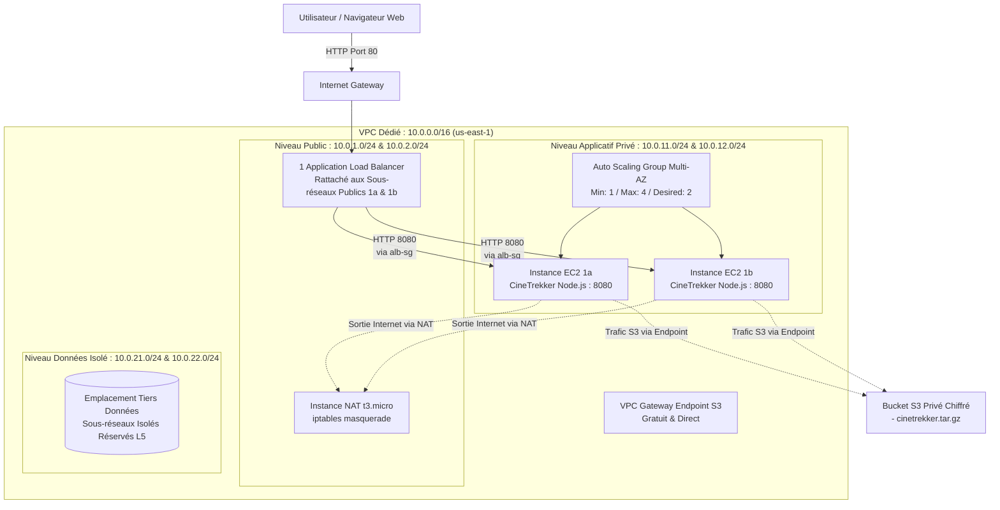

# DOSSIER D'ARCHITECTURE TECHNIQUE — PROJET AWS (L1-L3)
**CineTrekker Web Platform — Infrastructure Cloud Résiliente**

---

## 1. Schéma Global de l'Architecture Cible & Déployée

---

## 2. Découpage Réseau et Adressage (VPC 10.0.0.0/16)

| Sous-réseau | Zone de Disponibilité | Bloc CIDR | Rôle & Composants hébergés | Accès Internet |
| :--- | :--- | :--- | :--- | :--- |
| `public-subnet-1a` | `us-east-1a` | `10.0.1.0/24` | ALB (Nœud 1), Instance NAT | Direct via Internet Gateway |
| `public-subnet-1b` | `us-east-1b` | `10.0.2.0/24` | ALB (Nœud 2) | Direct via Internet Gateway |
| `private-app-subnet-1a` | `us-east-1a` | `10.0.11.0/24` | Première instance EC2 (Zone A) | Sortant uniquement via NAT |
| `private-app-subnet-1b` | `us-east-1b` | `10.0.12.0/24` | Instance EC2 (Zone B) | Sortant uniquement via NAT |
| `private-db-subnet-1a` | `us-east-1a` | `10.0.21.0/24` | Réservé Tiers Données | Aucun accès Internet (Isolé) |
| `private-db-subnet-1b` | `us-east-1b` | `10.0.22.0/24` | Réservé Tiers Données | Aucun accès Internet (Isolé) |

### Routage Explicite :
* **Table Publique (`public-rt`)** : Route `0.0.0.0/0 -> igw-xxxx`.
* **Table Privée Applicative (`private-rt`)** : Route `0.0.0.0/0 -> eni-xxxx` (Interface de l'instance NAT) + Route préfixée S3 vers le `VPC Endpoint Gateway`.
* **Table Base de Données (`db-isolated-rt`)** : Aucune route `0.0.0.0/0` (hermétique à tout trafic extérieur).

---

## 3. Matrice de Sécurité (Chaînage de Security Groups)

Le principe du **moindre privilège réseau** est rigoureusement appliqué : aucun groupe de sécurité ne référence d'adresse IP en dur pour les flux internes, tout passe par le référencement croisé d'identifiants de groupes (`Security Group Chaining`).

| Security Group | Règle Ingress | Port & Protocole | Source autorisée | Règle Egress |
| :--- | :--- | :--- | :--- | :--- |
| **`alb-sg`** | Web public | TCP 80 | `0.0.0.0/0` (Internet) | TCP 8080 vers `app-sg` uniquement |
| **`app-sg`** | Trafic applicatif | TCP 8080 | `alb-sg` exclusivement | - TCP 443 (S3 / AWS API) - UDP/TCP 53 (DNS) - TCP 80 (Mises à jour via NAT) |
| **`nat-sg`** | Routage privé | Tout protocole | `10.0.11.0/24`, `10.0.12.0/24` | `0.0.0.0/0` vers Internet |

> [!IMPORTANT]
> **Règle absolue** : Aucun port d'administration (22 SSH ou 3389 RDP) n'est ouvert sur `0.0.0.0/0`. L'administration des instances EC2 s'effectue exclusivement via **AWS Systems Manager (SSM) Session Manager**, nativement supporté par `LabInstanceProfile`.
