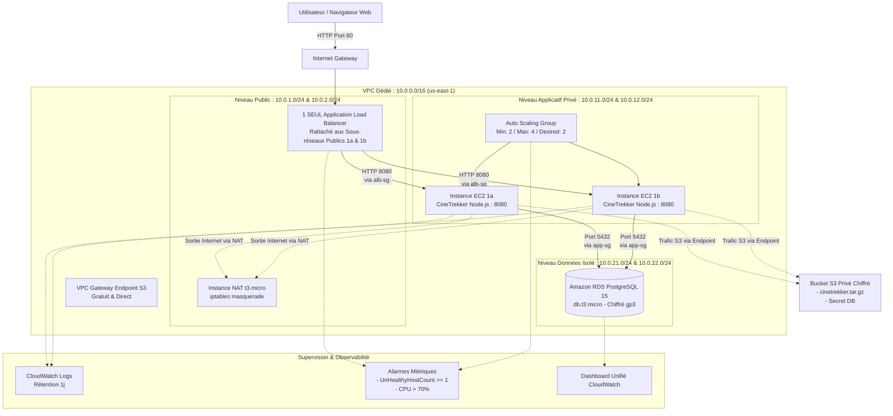

# DOSSIER D'ARCHITECTURE TECHNIQUE — PROJET AWS 3-TIERS
**CineTrekker Web Platform — Infrastructure Cloud Résiliente**

---

## 1. Schéma Global de l'Architecture Cible

---

## 2. Découpage Réseau et Adressage (VPC 10.0.0.0/16)

| Sous-réseau | Zone de Disponibilité | Bloc CIDR | Rôle & Composants hébergés | Accès Internet |
| :--- | :--- | :--- | :--- | :--- |
| `public-subnet-1a` | `us-east-1a` | `10.0.1.0/24` | ALB (Nœud 1), Instance NAT | Direct via Internet Gateway |
| `public-subnet-1b` | `us-east-1b` | `10.0.2.0/24` | ALB (Nœud 2) | Direct via Internet Gateway |
| `private-app-subnet-1a` | `us-east-1a` | `10.0.11.0/24` | Instances EC2 ASG (Zone A) | Sortant uniquement via NAT |
| `private-app-subnet-1b` | `us-east-1b` | `10.0.12.0/24` | Instances EC2 ASG (Zone B) | Sortant uniquement via NAT |
| `private-db-subnet-1a` | `us-east-1a` | `10.0.21.0/24` | RDS PostgreSQL (Subnet Group) | Aucun accès Internet (Isolé) |
| `private-db-subnet-1b` | `us-east-1b` | `10.0.22.0/24` | RDS PostgreSQL (Subnet Group) | Aucun accès Internet (Isolé) |

### Routage Explicite :
* **Table Publique (`public-rt`)** : Route `0.0.0.0/0 -> igw-xxxx`.
* **Table Privée Applicative (`private-rt`)** : Route `0.0.0.0/0 -> eni-xxxx` (Interface de l'instance NAT) + Route préfixée S3 vers le `VPC Endpoint Gateway`.
* **Table Base de Données (`db-isolated-rt`)** : Aucune route `0.0.0.0/0` (hermétique à tout trafic extérieur).

---

## 3. Matrice de Sécurité (Chaînage de Security Groups)

Le principe du **moindre privilège réseau** est rigoureusement appliqué : aucun groupe de sécurité ne référence d'adresse IP en dur pour les flux internes, tout passe par le référencement croisé d'identifiants de groupes (`Security Group Chaining`).

| Security Group | Règle Ingress | Port & Protocole | Source autorisée | Règle Egress |
| :--- | :--- | :--- | :--- | :--- |
| **`alb-sg`** | Web public | TCP 80 | `0.0.0.0/0` (Internet) | TCP 8080 vers `app-sg` uniquement |
| **`app-sg`** | Trafic applicatif | TCP 8080 | `alb-sg` exclusivement | - TCP 5432 vers `rds-sg` - TCP 443 (S3 / AWS API) - UDP/TCP 53 (DNS) - TCP 80 (Mises à jour via NAT) |
| **`rds-sg`** | Connexion DB | TCP 5432 | `app-sg` exclusivement | Aucun trafic sortant autorisé |
| **`nat-sg`** | Routage privé | Tout protocole | `10.0.11.0/24`, `10.0.12.0/24` | `0.0.0.0/0` vers Internet |

> [!IMPORTANT]
> **Règle absolue** : Aucun port d'administration (22 SSH ou 3389 RDP) n'est ouvert sur `0.0.0.0/0`. L'administration des instances EC2 s'effectue exclusivement via **AWS Systems Manager (SSM) Session Manager**, nativement supporté par `LabInstanceProfile`.

---

## 4. Justification des Services AWS au Regard du Cahier des Charges (§4.1)

| Service | Rôle dans l'Architecture | Justification & Respect des Contraintes Free Tier |
| :--- | :--- | :--- |
| **VPC & Sous-réseaux** | Socle d'isolation réseau | Service gratuit. Permet la segmentation stricte en 3 tiers. |
| **Internet Gateway** | Sortie Internet pour l'ALB | Service gratuit, nécessaire pour exposer le point d'entrée. |
| **Application Load Balancer** | Entrée unique & répartition de charge | Répartit le trafic sur les 2 AZs avec détection de panne (`/health`). |
| **Auto Scaling Group** | Haute disponibilité et élasticité | Service gratuit. Gère le cycle de vie des instances et remplace toute cible défaillante en < 5 min. |
| **EC2 (`t3.micro`)** | Exécution de l'application | Éligible Free Tier / Learner Lab (~0,0104 $/h). |
| **EBS gp3** | Disque racine (20 Go) | Volumes chiffrés par défaut, haute performance (3000 IOPS). |
| **Amazon RDS PostgreSQL** | Persistance relationnelle managée | Moteur PostgreSQL 15, `db.t3.micro`, chiffré, backups automatiques. Multi-AZ désactivé pour respecter le plafond de 50$. |
| **Amazon S3** | Stockage objet chiffré | Chiffrement SSE-S3 AES-256, accès public 100% bloqué. Stocke l'archive applicative `cinetrekker.tar.gz` et le secret DB chiffré. |
| **CloudWatch** | Logs, métriques et alarmes | Log group rétention 1 jour pour limiter les coûts. 2 alarmes actives déclenchables. Dashboard unifié. |

---

## 5. Solutions de Repli Face aux Contraintes du Learner Lab

1. **Restriction sur les Rôles IAM personnalisés** :
   * *Contrainte* : `iam:CreateRole` et `iam:PutRolePolicy` sont interdits dans AWS Academy.
   * *Solution de repli appliquée* : Utilisation systématique du profil d'instance pré-provisionné `LabInstanceProfile` et du rôle `LabRole`.
2. **Coût élevé du NAT Gateway managé AWS** :
   * *Contrainte* : 0,045 $/heure (~32,40 $/mois) = 65% du budget d'un étudiant.
   * *Solution de repli appliquée* : Déploiement d'une micro-instance EC2 NAT (`t3.micro`) avec `iptables`, combinée au S3 Gateway Endpoint gratuit. Coût divisé par 4 et arrêtable à la demande.
3. **Absence d'AWS Secrets Manager dans le catalogue Free Tier** :
   * *Contrainte* : Secrets Manager est facturé 0,40 $/secret/mois.
   * *Solution de repli appliquée* : Mot de passe RDS généré aléatoirement par Terraform (`random_password`), stocké dans un objet S3 chiffré SSE-S3 (`s3://.../secrets/db_password.txt`), lu à l'initialisation de l'instance par `LabInstanceProfile`. Aucun secret dans Git ni dans le User Data.
